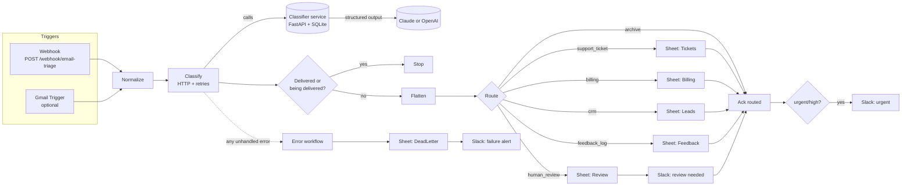
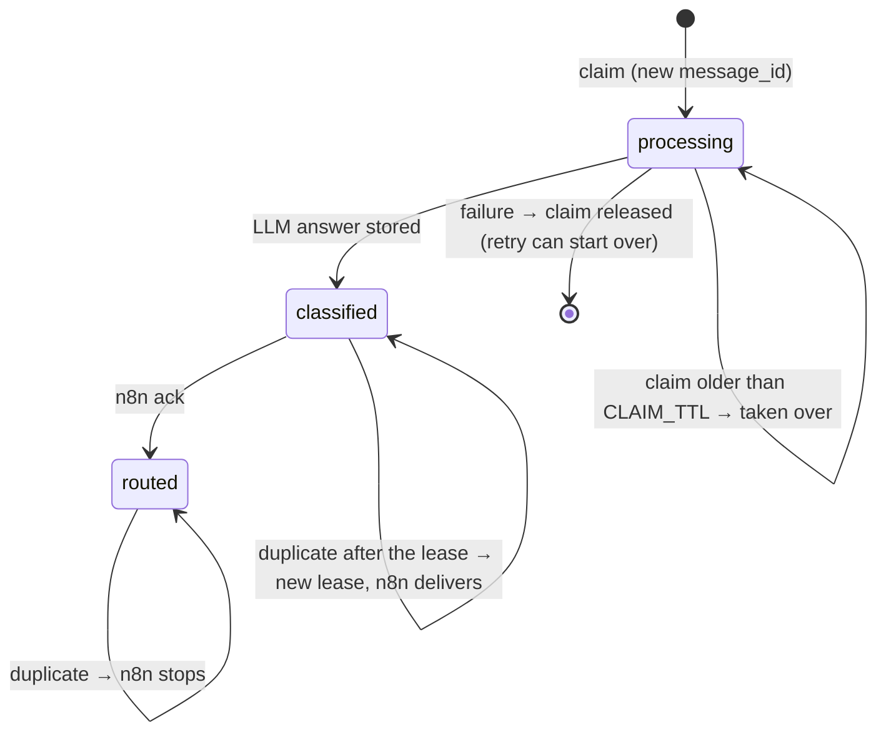

# Email Triager: design and process breakdown

This document explains how the triage pipeline works, step by step, and why each part is
built the way it is. The README covers how to run it.

---

## 1. The problem

A small B2B software company runs one shared inbox (`support@`). Everything lands there:
bug reports, refund requests, locked-out users, sales enquiries, feature ideas, phishing,
and SEO spam. Someone has to read every email to decide where it goes. That costs time,
urgent problems wait behind newsletters, and sales leads go cold.

**Goal:** every incoming email is labeled within seconds and delivered to the right place.
Urgent issues get flagged right away, and anything the system is unsure about goes to a
person instead of being guessed.

**Success criteria**

| Criterion | How it's met |
|---|---|
| Correct routing of clear-cut emails | LLM classification with a fixed label set; measured with an eval set |
| Unclear emails are never auto-routed wrongly | Confidence threshold plus explicit review rules, all routed to `human_review` |
| No email lost, none processed twice | Idempotency keyed on `message_id`, retries, a dead-letter path |
| Swap LLM vendor without touching the workflow | Provider abstraction behind one HTTP endpoint |
| Auditable | Every result stores the model, prompt version, rationale and review reasons |

**Non-goals (on purpose, to keep it finished rather than sprawling):** writing reply
drafts, multi-language tuning, attachment parsing, a custom UI. See section 10.

---

## 2. Architecture



There are two parts with a clear split of responsibilities:

- **n8n owns orchestration:** triggers, connecting to SaaS tools, retries on HTTP steps,
  branching, notifications, and the error workflow. It's the part a client's operations
  team can see and change.
- **The classifier service (Python/FastAPI) owns judgment and state:** the prompt, the LLM
  call, validating the answer, the review rules, the routing table, and idempotency. It's
  the part that needs code review, tests, and evals.

---

## 3. The process, step by step

### Step 1: Trigger

**What:** an email arrives through one of two entry points:
- **Webhook** (`POST /webhook/email-triage`, header `X-Webhook-Secret`). Any system can
  forward to it: a helpdesk, a mail-forwarding service, a contact form, or the sample script.
- **Gmail Trigger** (disabled by default) polls an inbox every minute.

**Why both:** the webhook makes the pipeline testable and independent of any one email
provider, and is how most client systems (Zendesk, Front, Postmark inbound) push events.
Gmail is the common small-business case and shows a native n8n integration.

**Details:**
- The webhook answers **202 Accepted immediately**, before classification. An LLM call takes
  seconds, and senders such as mail forwarders time out or retry when a webhook is slow.
  Answering early decouples their retry logic from ours.
- The webhook is authenticated with a header secret stored as an n8n credential. That
  credential is generated from `.env` at startup, so the secret is never in git.

### Step 2: Normalize

**What:** a Code node maps either input shape into one canonical object:
`{message_id, sender, subject, body, received_at}`. If `message_id` or `sender` is
missing, it throws an error.

**Why:** everything downstream depends on this one contract, so adding a third trigger (for
example Outlook) means touching only this node. Rejecting a payload without a `message_id`
is deliberate: without a stable ID there is no idempotency, so it's safer to dead-letter
the payload than to risk processing it twice.

### Step 3: Classify (n8n → classifier service)

**What:** an HTTP Request node calls `POST /v1/classify` with the shared `X-API-Key`.
It retries up to 4 times, 5 s apart, with a 90 s timeout.

Inside the service, in order:

1. **Idempotency claim.** The service looks up `message_id` in SQLite (state machine in
   section 4):
   - New: claim it (`processing`) and continue.
   - Seen before: return the stored result with `duplicate: true` and a status of
     `routed`, `delivering` or `classified` (step 4 explains each). **No second LLM call.**
   - Being processed right now by another request: `409` with `Retry-After: 5`.
   - Same ID but different content: `422`. This is a bug or tampering; never overwrite.
2. **Input guards.** The body is cut to `MAX_BODY_CHARS` (12k by default; the response says
   `body_truncated: true`, so nothing is cut silently). Empty emails skip the LLM and go
   straight to review.
3. **Prompt assembly.** A fixed system prompt (label definitions, tie-break rules,
   priority rubric, confidence guidance, and injection handling) plus the email wrapped in
   `<email>` tags. Any `</email>` inside the email is escaped so the email can't close the
   data block early.
4. **LLM call with structured output.** The provider must return JSON matching a strict
   schema: `category` (enum), `priority` (enum), `confidence`, `summary`, `rationale`.
   - Claude: `output_config.format` with a JSON schema, `effort: low`, plus the server-side
     refusal fallback on models that support it.
   - OpenAI: Responses API with `text.format` set to a strict `json_schema`.
5. **Validation.** The JSON is validated again with Pydantic, which also checks things the
   provider schema can't express (confidence between 0 and 1, length limits). An invalid
   answer or a refusal is **retried once**. If it fails again, the email gets a fallback
   classification and goes to review with the reason `llm_output_invalid`.
6. **Review rules** (deterministic code). An email goes to `human_review` if any of these
   apply:
   - `confidence < CONFIDENCE_THRESHOLD` (default 0.75): `low_confidence`
   - the category is `other`: `category_other`
   - the text matches prompt-injection patterns: `possible_prompt_injection`
   - the LLM output was unusable, or the email was empty
7. **Routing.** A fixed table maps category to route (section 4). `notify` is true for
   `urgent`/`high` priority unless the email is being archived.
8. **Persist.** The full result is stored (status `classified`) and a **delivery lease**
   starts (120 s by default; see step 4). A structured log line is written. The log has the label, confidence, route and latency, but **never the body**.

**Why a separate service rather than n8n's built-in AI nodes:** see decision D2.

### Step 4: Skip if already delivered or being delivered

**What:** for a duplicate, the service's `status` decides what happens next:

| Status | Meaning | n8n |
|---|---|---|
| `routed` | an earlier run delivered it | stop |
| `delivering` | another run got the result within the last 120 s and is delivering it now | stop |
| `classified` | an earlier run classified it but never acked, and its lease has run out, so that run failed | **carry on and deliver** |

**Why:** this closes the loop on idempotency. Dedupe by ID alone has two classic bugs, and
the three statuses avoid both:
- *Dropping work:* if every duplicate is skipped, an email whose first run failed after
  classification is never delivered. `classified` lets the retry finish the job.
- *Doing work twice:* if every unacked duplicate continues, two copies arriving a few
  seconds apart both deliver, because the first hasn't acked yet. The delivery lease
  (`delivering`) stops the second copy. If the first run then fails, nothing is lost:
  its failure is already in the dead-letter queue.

The lease (120 s) is set longer than the worst-case delivery time in n8n (Sheets and ack
retries, about 45 s), so a healthy run always acks inside it.

### Step 5: Flatten and route

**What:** the nested response is flattened into one row (timestamp, sender, subject,
category, priority, confidence, summary, rationale, route, review reasons, model, prompt
version). A Switch node then branches on `route`.

**Why:** the route is computed by the service, so the n8n Switch is a plain lookup with no
logic to duplicate or drift. The flat row means every Google Sheet tab shares one header
layout.

### Step 6: Deliver

| Route | Destination | Notes |
|---|---|---|
| `support_ticket` | Sheet `Tickets` | technical_support and account_access |
| `billing` | Sheet `Billing` | |
| `crm` | Sheet `Leads` | stands in for HubSpot/Pipedrive (decision D8) |
| `feedback_log` | Sheet `Feedback` | |
| `human_review` | Sheet `Review` + Slack message | shows the model's best guess and why it's under review |
| `archive` | nothing recorded | spam; still acked so it is never retried |

Sheets nodes retry 3 times. If a destination still fails, the run errors **before** the ack,
so the message stays `classified`. Once the lease runs out, a retry finishes the delivery
(step 4).

### Step 7: Ack

**What:** `POST /v1/messages/{id}/ack` marks the message `routed`. The call is idempotent:
acking twice is fine.

**Why:** the classifier can't know whether n8n delivered the email; only n8n knows. The ack
records "delivered", which is what lets step 4 tell "finish this" from "already done".
Acking also ends the delivery lease: from then on, every copy is `routed`.

### Step 8: Notify

**What:** for `urgent`/`high` items (not review or archive), a Slack incoming webhook posts
the priority, category, subject and one-line summary.

**Why it comes after the ack:** the system of record (the sheet) matters more than the ping.
Slack nodes use `continueRegularOutput`, so if Slack is down the email is still delivered
and marked routed. A missed notification is a smaller problem than a lost email.

### Step 9: Error path (dead letter)

**What:** the main workflow names an **error workflow**. Any unhandled failure (bad
payload, classifier unreachable after retries, a provider outage, a destination failing
after retries) starts it:

1. Build a dead-letter row: time, workflow, execution ID, a link to the failed execution,
   the failed node, and the error message.
2. Append it to the `DeadLetter` sheet. If that fails too, the run continues to step 3.
3. Post a Slack alert with the link.

**Recovery:** n8n keeps the failed execution with its full input. An operator fixes the
cause (a refreshed Google token, provider credit) and presses **Retry** in n8n. Retrying
is safe because the classifier is idempotent: an already-classified email isn't billed
again, and an already-routed one isn't delivered twice.

**Why not a queue:** see decision D7.

---

## 4. The classifier service internals

### Message state machine



- The claim uses `BEGIN IMMEDIATE`, which takes SQLite's write lock up front. That makes
  "read state, then insert" atomic across concurrent requests, the same way the booking API
  used Postgres advisory locks.
- **Claim TTL (180 s):** if the process crashes mid-call, the `processing` row would block
  the message forever. After the TTL a new request takes the claim over.
- **Delivery lease (120 s):** handing out a result starts a lease. Duplicates inside it are
  told `delivering`; after it, the next duplicate takes over delivery (step 4).
- **Content hash:** SHA-256 of sender, subject and body. If the same `message_id` arrives
  with different content, the service answers `422` and doesn't overwrite. This follows
  the same idea as Stripe's idempotency keys.

### Routing table (code, not prompt)

```python
ROUTE_BY_CATEGORY = {
    billing:           billing,
    technical_support: support_ticket,
    account_access:    support_ticket,
    sales_lead:        crm,
    feedback:          feedback_log,
    spam:              archive,
    other:             human_review,
}
```

A test checks that every category has a route, so adding a label without a destination
fails CI.

### HTTP contract

| Endpoint | Success | Errors |
|---|---|---|
| `POST /v1/classify` | 200 + result | 401 key, 409 in progress (`Retry-After: 5`), 422 invalid or ID reused, 500 provider misconfigured, 503 provider down (`Retry-After: 30`) |
| `POST /v1/messages/{id}/ack` | 200 | 404 unknown, 409 still processing |
| `GET /v1/messages/{id}` | 200 + stored result | 404 |
| `GET /healthz` | 200 | n/a |

The status codes are chosen so that n8n's generic "retry on failure" does the right thing:
409 and 503 are temporary and clear up on retry. 422 and 500 won't, and after the retries
are used up they land in the dead-letter path, where a human looks at them.

---

## 5. Failure modes and how each is handled

| Failure | Detected by | Handling | End state |
|---|---|---|---|
| Webhook called without or with a wrong secret | n8n header auth | 403, no execution | Nothing processed |
| Payload missing `message_id`/`sender` | Normalize throws | Error workflow | Dead letter + Slack alert |
| Classifier container down or restarting | HTTP error | 4 tries × 5 s, then error workflow | Dead letter; retry later is safe |
| LLM rate limit, 5xx, or timeout | SDK retries ×2, then `503` | n8n retries, then error workflow | Dead letter; nothing billed twice |
| Wrong API key or model name | `500` | Error workflow | Dead letter + alert (needs an operator) |
| LLM refuses, truncates, or returns off-schema JSON | stop reason + Pydantic | 1 retry, then fallback | `human_review` with `llm_output_invalid` |
| LLM is unsure | confidence < threshold | Review rule | `human_review` with `low_confidence` |
| Prompt injection inside the email | pattern match + prompt instruction | Review rule (label kept, not trusted) | `human_review` |
| Same email delivered twice | idempotency store | Stored result returned; routed ones stop | Delivered exactly once |
| Second copy arrives while the first is still delivering | delivery lease | Answered `delivering`; n8n stops the copy | Delivered once; if the first run fails, it's in the dead-letter queue |
| Two copies at the same moment | `processing` claim | Second gets `409`, n8n retries | Classified once |
| Process crashes mid-LLM call | claim TTL | Next delivery takes the claim over | Classified once |
| Sheet or Google auth fails | Sheets node error after 3 tries | Error workflow, before the ack | Dead letter; message stays `classified`, and a retry after the lease delivers it |
| Slack down | HTTP error | Continue anyway | Email delivered; ping missed (logged in the execution) |
| Huge email | length check | Truncated to 12k chars, flagged | Classified on the first 12k chars |

---

## 6. Design decisions and trade-offs

### D1. n8n vs Make vs Zapier
**Choice: n8n (self-hosted).**
- *For n8n:* it can be self-hosted, so email content stays on the client's infrastructure,
  which matters for support mail with PII. Its Code nodes allow real JavaScript, it has a
  first-class error-workflow concept, and workflows export as JSON that lives in git (this
  repo imports them at startup). Pricing doesn't climb per task as volume grows.
- *For Make:* a nicer visual debugger and good built-in error handlers ("break", "resume",
  "rollback"). It would be a fine choice for a non-technical client who wants SaaS only.
- *For Zapier:* the largest app catalogue and the fastest setup, but weaker branching and
  error handling, and per-task pricing becomes expensive at inbox volume.
- *What would change the choice:* a client already paying for Make or Zapier with no
  self-hosting requirement. The classifier is a plain HTTP API, so it works unchanged
  behind either tool.

### D2. A separate classifier service instead of n8n's AI nodes
**Choice: a small FastAPI service called over HTTP.**
- *For:* prompts, schema, review rules and routing live in versioned code with **unit
  tests** (28 run offline) and an **eval harness**. The same logic can serve any
  orchestrator. The LLM provider is swapped with one env var. Idempotency needs a
  transactional store, which n8n's built-in nodes can't provide atomically.
- *Against:* one more container to run and monitor, and a network hop.
- *When I'd skip it:* a one-off internal workflow with low stakes. There, n8n's AI Agent or
  OpenAI node with a structured output parser is fine and quicker to build.

### D3. Structured outputs instead of "please reply in JSON"
**Choice: provider-enforced JSON schema (constrained decoding), then Pydantic validation.**
- Asking for JSON in the prompt fails some percentage of the time (stray prose, markdown
  fences, invented labels). Constrained decoding makes the output **always parse and always
  use a valid enum value**.
- Pydantic still re-checks, because the provider schema subset can't express bounds such as
  0 ≤ confidence ≤ 1, and because refusals and truncation are separate failure modes.
- Tool calling would also work, but structured output is the direct tool for "return this
  shape": there's no tool loop to manage.

### D4. The LLM labels; code decides
The model only outputs a category, priority and confidence. **Routes, notifications and
review decisions are deterministic code.** This means:
- a prompt change can't silently send emails somewhere new;
- a successful prompt injection can at worst change a label, never trigger an action (the
  model has no tools);
- routing rules can be reviewed and unit-tested like any other code.

### D5. How low-confidence emails are handled
- The model reports a confidence and the prompt tells it not to default to high numbers.
  **LLM self-reported confidence is only roughly calibrated.** It's useful for ranking,
  not as a true probability. So the threshold is **set empirically**: run
  `evals/run_eval.py`, look at *auto-route precision* (how often the emails that skipped
  review were right) against *review rate*, and pick the trade-off the business wants.
- `other` always goes to review, even with high confidence, because "doesn't fit" is
  exactly what a human should see.
- Reviewers see the model's best guess and rationale, so a review takes seconds rather
  than a full re-read.
- *Considered and not built yet:* self-consistency (classify twice, flag disagreement), or
  per-token probabilities where the provider exposes them. Both cost more; the threshold and
  eval approach is the cheaper first step.

### D6. Idempotency key = `message_id`
- Email has a natural unique ID (the Gmail message ID, or the RFC 5322 `Message-ID`
  header), and every redelivery source (n8n retry, sender retry, Gmail re-poll, manual
  replay) keeps it.
- Paired with a content hash so a reused ID is caught rather than trusted.
- Two-phase state (`classified` → `routed`) plus a delivery lease, instead of a single
  "seen" flag. Section 3, step 4 explains why.

### D7. n8n's error workflow plus a dead-letter sheet instead of a message queue
- A queue (SQS, RabbitMQ, Vercel Queues) gives durable retries with backoff and is the
  right step up at higher volume or when n8n runs in queue mode.
- For one inbox (hundreds of emails a day), n8n's built-in execution retry, saved failed
  executions, and a visible dead-letter list cover it with no extra infrastructure. The
  idempotent classifier is what makes manual retries safe.

### D8. Google Sheets as tickets and CRM, Slack via incoming webhook
- Sheets is something every client can open, and it makes the demo visible. In production
  each tab maps to a real system: Tickets → Zendesk/Jira/Linear, Leads → HubSpot/Pipedrive.
  Swapping one is a single node change, because the row contract stays the same.
- Slack **incoming webhooks** only need a URL (no OAuth app), which is enough for one-way
  notifications.

### D9. SQLite instead of Postgres for the idempotency store
- One classifier replica handles inbox volume easily. SQLite in WAL mode with
  `BEGIN IMMEDIATE` gives correct concurrent claims with nothing extra to run.
- **What would change it:** more than one replica, or serverless hosting. Then the same
  state machine moves to Postgres (`INSERT ... ON CONFLICT` plus a row lock), the pattern
  from the booking API. The store is one small class, so the swap is contained.

### D10. Model and effort
- The default is Claude Opus 5.5 at `effort: low`. Classification doesn't need deep
  reasoning, and low effort keeps latency and token use down without dropping to a
  smaller model.
- Cost per email is small either way (about 1k input tokens for prompt plus a typical email). For
  high volume, a cheaper model (Claude Haiku 5.5, or OpenAI's small models) is a one-line
  `.env` change. **That should only be done after the eval shows quality holds.**
- The server-side refusal fallback is enabled on models that support it, so a rare
  safety-classifier decline on an unusual email is retried on another model instead of
  failing.
- Prompt caching isn't used: the system prompt is below the minimum cacheable prefix size,
  so caching would have no effect.

### D11. Prompt-injection defense in depth
Email is untrusted input written by strangers. The layers are:
1. Prompt: the email is marked as data inside `<email>` tags, with an explicit rule that
   instructions inside it must not be followed.
2. Tag escaping, so the email can't close the data block.
3. Output constrained to a schema with enums, so free-text instructions can't leak into
   actions.
4. No tools and no actions for the model (D4).
5. A heuristic regex forces review on suspicious phrasing.

### D12. Privacy
- Logs contain IDs, labels and timings, **never email bodies**.
- With self-hosted n8n, email content only leaves the client's infrastructure for the LLM
  API call.
- n8n keeps execution data (including email content) for debugging. In production, set
  execution pruning (`EXECUTIONS_DATA_MAX_AGE`) to match the client's retention policy.

---

## 7. Testing and evaluation

| Layer | What | How to run |
|---|---|---|
| Unit and API tests | Routing, review rules, idempotency (duplicate, concurrent, conflict, crash, delivery lease), retries, error mapping, truncation, injection flag, provider response parsing | `cd classifier && uv run pytest` (offline, under 2 s) |
| Eval (quality) | 30 labeled emails, including hard cases: mixed intents, injection, vague one-liners, fake urgency | `uv run python -m evals.run_eval` (calls the real LLM, costs cents) |
| End-to-end | The whole stack in Docker; webhook → n8n → classifier → route → ack, including duplicate and error paths | `LLM_PROVIDER=fake docker compose up`, then `scripts/send_samples.py` |

The **fake provider** (keyword rules) lets the whole pipeline and the test suite run with no
API key. It also serves as a baseline: rules score **67% category accuracy** on the eval
set. An LLM has to clearly beat that to justify its cost.

---

## 8. Security summary

- Webhook: header-secret auth (n8n credential generated from env).
- n8n → classifier: shared `X-API-Key`, compared in constant time.
- Secrets live only in `.env` (gitignored). `.env.example` documents every variable.
- The classifier container runs as a non-root user.
- Unknown fields in the payload are ignored, and size limits apply to every field.

## 9. Cost and latency (rough)

- Tokens per email: about 700 for the system prompt plus the email (usually 100–1,000) in,
  and about 120 out.
- Latency is dominated by the LLM call (seconds). The sender never waits for it, because
  the webhook answers 202 first.
- Duplicate deliveries cost nothing: they're answered from the store.

## 10. Known limitations and next steps

- **Only one classifier replica** (SQLite). Next step: a Postgres store (D9).
- **Confidence is self-reported.** Next: calibrate the threshold on real traffic, and
  consider self-consistency for borderline cases.
- **English-centric prompt and eval set.** Next: add multilingual examples to the eval.
- **Thread awareness:** replies in an existing thread are classified as new emails. Next:
  route by thread ID when an earlier message in the thread is known.
- **No attachment handling:** only text is classified.
- **The review loop isn't closed:** human corrections in the Review sheet aren't fed back.
  Next: collect them as new eval cases (the cheapest way to improve the prompt).
- **The Gmail path** is wired and documented, but the demo uses the webhook.
